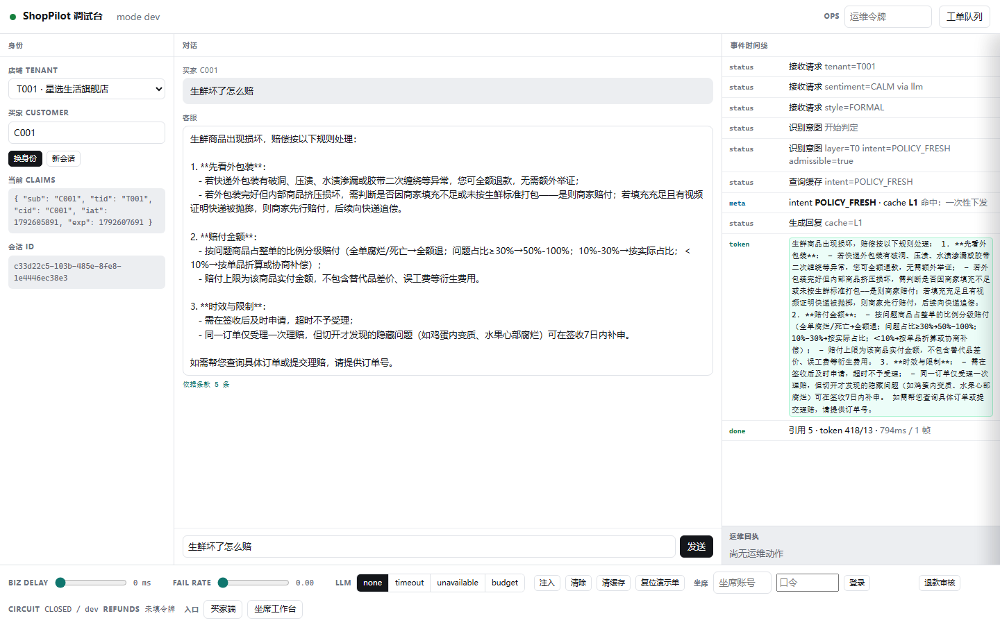
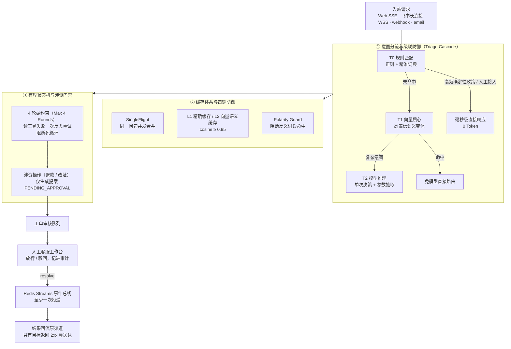
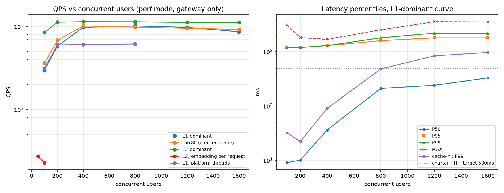
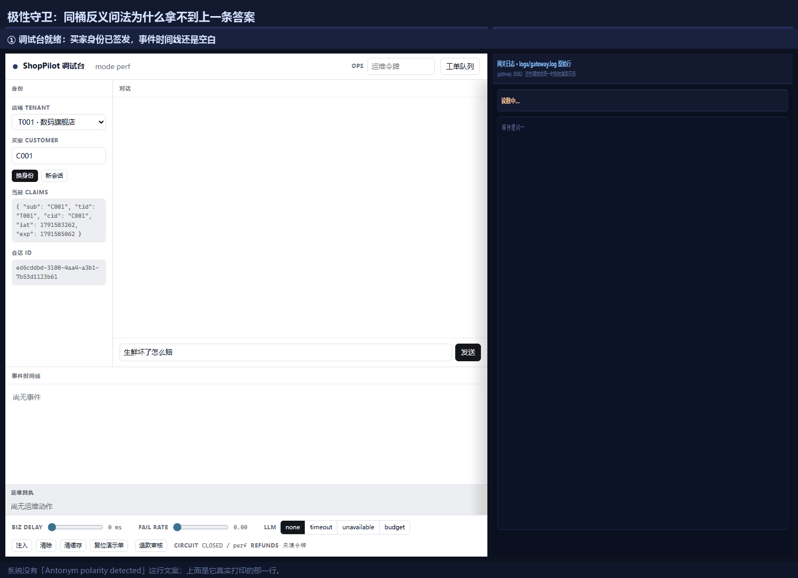
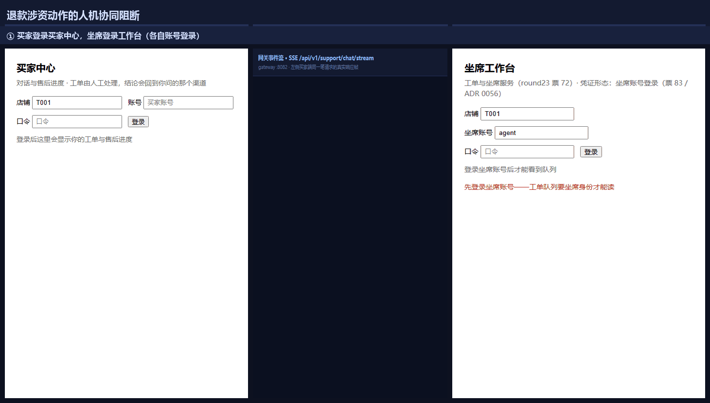
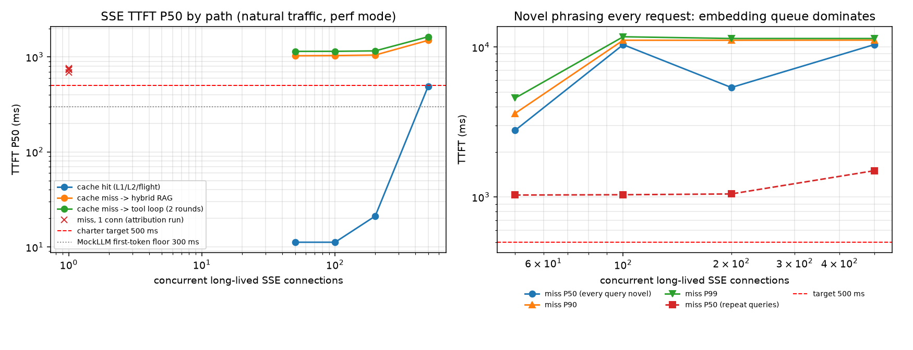

<div align="center">

# Shoppilot

**面向不可靠大模型的防御式 Agent 运行时与高可用网关底座**

[](https://openjdk.org/projects/loom/)
[](https://spring.io/projects/spring-boot)
[](https://openjdk.org/jeps/444)
[](docs/adr/)
[](#-端到端评测门禁)
[](https://github.com/shing26/shoppilot/actions/workflows/ci-subset.yml)

**10** 态有界状态机 · **4** 轮工具硬上限 · 命中路径 **P99 22 ms**（200 并发） · 800 并发 **0 错误率**

<p align="center">
<a href="#-架构与工程验证索引">核心索引</a> •
<a href="#-架构拓扑与数据流向">架构拓扑</a> •
<a href="#-四大防御式工程支柱">工程支柱</a> •
<a href="#-基准压测与现场证据">性能证据</a> •
<a href="#-快速开始一条命令">快速开始</a> •
<a href="#-端到端评测门禁">评测体系</a>
</p>



</div>

---

## 🧭 先看这里

- **项目定位（2026-10-26 决策）**：本项目按 **“可验证、可审计、可回归的受控 Agent 运行时”** 讲，
  不按“通用智能客服平台”讲。一页纸叙事、对比矩阵、3 分钟演示脚本与 14 天收口清单见
  [`docs/ROUTE_A_TRUSTED_RUNTIME.md`](docs/ROUTE_A_TRUSTED_RUNTIME.md)；
  三条路线的取舍依据见 [`docs/PRODUCT_POSITIONING_DECISION.md`](docs/PRODUCT_POSITIONING_DECISION.md)；
  对外技术文章见 [`docs/WHY_VERIFIABLE_BEATS_SMARTER.md`](docs/WHY_VERIFIABLE_BEATS_SMARTER.md)。
- **业务侧读者（客服主管 / 运营 / 产品）**：先读
  [《两个能跑的场景：一份给业务侧的一页纸》](docs/round32-two-runnable-scenarios.md)——
  三分钟能复述**谁在问、走哪几步、哪一步转人、什么情况办不了、现在哪段没通**。
  它只讲业务、不复述指标；所有数字与未达成项仍只在本文与 [`docs/EVIDENCE.md`](docs/EVIDENCE.md) 维护。
- **工程读者**：从下面的[架构与工程验证索引](#-架构与工程验证索引)进入，或直接看
  [快速开始](#-快速开始一条命令)。要降低模型依赖、修当前评测红点，按
  [`docs/TUNING_PLAN.md`](docs/TUNING_PLAN.md) 的三周路线执行。
- **外部评审者（60 秒）**：`python scripts/demo.py --up`（Docker + Python 3.11+ + Ollama `bge-m3`）——容器档 demo 档（意图感知模板）起全栈并跑三个场景。当前测试数/覆盖率/指标口径只看
  [`docs/STATUS.md`](docs/STATUS.md)；历史读数与未达成项在 [`docs/EVIDENCE.md`](docs/EVIDENCE.md)，两处不要混读。
- **Docker Hub 401 / Maven 网络不通**：用镜像站基础镜像（`SHOPPILOT_MAVEN_IMAGE` / `SHOPPILOT_JRE_IMAGE`，见 RUNBOOK），或 `python scripts/demo.py --prebuilt`（用本机已构建 jar，不走 Dockerfile 的 Maven stage）。

> **核心哲学**：大模型本质是具有随机性、高延迟与幻觉风险的概率引擎。**Shoppilot** 不盲目采用重型封装的黑盒 Agent 框架，而是基于 **Spring MVC + Java 21 虚拟线程**，以确定性的经典系统工程手段为大模型交互构建高吞吐、防击穿、防死循环与涉资不可抵赖的工业级运行底座。

发布声明与冻结策略见 [RELEASE.md](RELEASE.md)；逐条数字的证据文件与复现命令见 [`docs/EVIDENCE.md`](docs/EVIDENCE.md)——**未达成的也照写**。

---

## 🧭 架构与工程验证索引

为技术评审者与架构师快速定位核心决策与实测数据的对应出处：

| 评估维度 | 依据路径 | 关键设计考量与实测读数 |
| :--- | :--- | :--- |
| **架构决策演进** | [`docs/adr/`](docs/adr/) | 77 个编号 / 76 篇成文（ADR-0022 有意预留未占用），包含完整选型权衡、备选方案与后果推演。 |
| **高并发压测与模型剥离** | [`docs/loadtest-report.md`](docs/loadtest-report.md) | 剥离模型端网络波动：每请求实打 bge-m3 为 24–65 QPS，编排层三条带缓存曲线在 1000 QPS 附近压平。 |
| **静默故障定位与复盘** | [`docs/incident-2026-10-silent-failure-modes.md`](docs/incident-2026-10-silent-failure-modes.md) | 门禁全绿下的 Redis 异步事件断流真实定位；通过 `MONITOR` 取证与新增 0-token 判据抓出三个静默缺陷。 |
| **全套技术栈本地运行** | [快速开始](#-快速开始一条命令) | `pwsh -NoProfile -File scripts/up.ps1`；容器档严格执行凭据校验，空凭证由启动守卫拒启。 |

---

## 🏗️ 架构拓扑与数据流向

流量自统一接入端点进入，按「意图级联防御 → 并发缓存防击穿 → 有界状态机约束 → 涉资动作人工门禁」逐层收敛：



各格的源码落点见 [`docs/CODE_MAP.md`](docs/CODE_MAP.md)；状态机逐态说明见下文「请求主链路」。

---

## 🛡️ 四大防御式工程支柱

### 1. 三级意图级联防御 (T0/T1/T2 Cascade)

拒绝让大模型无节制充当流量入口：

* **T0 规则层**：正则与精准词典强匹配，毫秒级直接阻断高频确定性咨询（如运费险规则、人工客服转接），0 LLM Token 消耗；字面「转人工」在 T0 定案，向量服务挂了也转得出去（ADR 0017）。
* **T1 向量质心层**：常见问句的语义变体通过质心距离快速定案意图，高置信度直接路由，不触发模型。
* **T2 模型推理层**：仅当意图发散、多槽位缺失或存在复合语义时，才将请求下发至大模型进行单次决策。

### 2. 有界状态机（4 轮上限）与涉资操作门禁 (Bounded FSM & HITL)

* **有界执行（Max 4 Rounds）**：硬编码截断 Agent ReAct 模式下的发散递归调用，单会话工具交互上限强制为 **4 轮**（计划步数与工具轮同源、自动 ≤4）；超轮次落 `TOOL_ROUNDS_EXHAUSTED` 可查工单，不拿失败前提硬办后步。
* **一次反思重试（读工具限定）**：读工具遇操作性失败（`TIMEOUT` / `UNAVAILABLE`）时由系统把失败事实回填上下文、让模型换一种做法再试**一次**——占同一份轮次预算、按工具合计 1 次、写工具不反思、**任何闸（归属 / 编造 / 幂等 / 审批 / 终态 / 行业门）判定都先于反思**，重试撞闸走该闸原出口。三态（触发 / 不触发 / 次数用尽）可枚举可判：`plan[].attempt` / `plan[].reflection` + `shoppilot_reflection_total{outcome}` + trace 的 `reflection=<tool> attempt=<n>` 行。
* **涉资动作权责分离**：模型针对退款、修改地址等敏感工具调用仅具备「提案权」，执行状态标记为 `PENDING_APPROVAL`，必须通过 Redis Streams 流转至人工审核工作台放行，杜绝越权幻觉与不可抗抵赖风险。

### 3. L1/L2 双层缓存与极性守卫 (Polarity Guard)

* **SingleFlight 并发合并**：同一问句在突发高并发下自动合并，单周期内仅允许穿透一次底层检索/模型推理（等待者拿完整结果，不做 token 流广播），防止线程池打满与配额雪崩。
* **极性词法守卫**：针对高维向量在短句反义场景下的特征聚集缺陷（如「这个能退吗」与「这个不能退吗」余弦相似度高达 0.9799），在跨过 0.95 相似度阈值后增加词法极性冲突检测（`polarity-conflict`），一旦命中反义虚词翻转即强制判定 Cache Miss 并穿透；历史条目缺失原始问法时 fail-closed（ADR 0016）。

### 4. 虚拟线程原生并发调度 (Project Loom)

* **摒弃 Reactive/WebFlux 复杂度**：保留直观易调试的 Spring MVC 同步编程心智，底层全面基于 **Java 21 Virtual Threads** 承载高并发网络 I/O。
* **实测收益**：压测对照组（同模型同并发，仅关闭 `spring.threads.virtual.enabled`）显示 400 / 800 并发吞吐 **+64% / +65%**；100 / 200 并发无排队时反而 **-3%**——低并发负收益与高并发收益一并照登，不挑好看的说。

---

## 📊 基准压测与现场证据

### 1. 运行态防御对比矩阵

**先说清楚这张表的对照口径**：没有对第三方 Agent / 裸 LLM 的横评——两列是**同一套流量模型、同一台机器、同一份计数器口径下，把防线逐个关掉**测出来的（`loadtest/results/ladder-*` 各档）；关掉防线的那个「自己」，就是这个系统里裸调的等价物。

| 评估维度 | 防线关闭（同仓实测） | 防线开启（同仓实测） | 工程收益说明 |
| :--- | :--- | :--- | :--- |
| **命中路径延迟** | 无缓存：每请求全价走检索 + 模型调用 | **P99 22 ms**（200 并发；100 并发 32 ms），模型与远程向量化增量恒为 0 | 高频咨询不进模型 |
| **未命中 TTFT（知识路径）** | 同上，全价路径 | **P50 690 ms（1 并发串行）→ 1499 ms（500 并发）**；判据 500 ms，**未达成红值照登** | SingleFlight 合并同类穿透；归因显示网关编排自身仅 104 ms |
| **冷缓存击穿** | 8 分钟 **35264 次**远程 embedding 全部失败，拦截率掉到 0 | 同类并发合并后 **18 次**，拦截率回到 **77.6%** | 进程内向量 LRU + 穿透合并 |
| **反义短句缓存判定** | 同桶反义对越过 0.95 工作点（标定示例对 **0.9682**，四对越界最大 **0.9802**），阈值与意图分区都拦不住 | 极性守卫词法判定，反义对 **8/8 不互命中** | 阻断虚假命中造成的错误答复，且不调阈值换召回 |
| **调用边界失控** | 自由循环直到「任务完成」，没有轮次上界 | **4 轮硬上限**，超限落 `TOOL_ROUNDS_EXHAUSTED` 可查工单 | 50 并发同幂等 token 仍只产生 1 行退款 |
| **单请求 token** | **1096.8** token/请求（nocache,nosf 档） | **412.3** token/请求 | 节约 **62.4%**（perf 的 Mock 按模板估算，非计费口径） |

未达成的三条（拦截率、吞吐、TTFT）归因写在一起，完整口径、逐行证据与「红在哪」见下文「指标与口径」；三条**保持红值**，不改分母刷绿。



左图对数轴：三条带缓存的曲线在 1000 QPS 附近压平；关掉虚拟线程那条 615、向量服务停用那条 482，而每请求真打一次 bge-m3 那条只有 24-65 QPS。右图是 L1 主导曲线的分位数与命中路径 P99，虚线为任务书 500 ms 的 TTFT 判据。

### 2. 现场录屏实录

这一节不放宣传截图，只放两段当场抓取的真实链路录屏：

<div align="center">

**① 极性守卫阻断** — 实测高相似反义句越过 0.95 阈值触发 L2 命中时，被守卫判定 `polarity-conflict` 并强制穿透的真实日志与响应流。



</div>

<div align="center">

**② 涉资动作人机协同门禁** — 买家触发退款后，模型工具调用生成待审提案，工单系统流转至工作台审核放行的闭环过程。



</div>

> **现场实录前置边界说明**：
> 1. **模型基准**：两段录屏运行在 `perf` 档位（固定输出 MockLLM + 真实 bge-m3 + 真实 Qdrant/ES/Redis）；当前产品页/容器演示默认 `demo` 档（意图感知模板）。两者都不是真实模型质量证据：被演示的链路（语义缓存、极性守卫、工具编排、人机审核、审计）真实发生，模型侧答案由模板产出。
> 2. **真实日志签名**：极性守卫拦截日志为真实输出行（`CacheService`）：`L2 语义命中被极性守卫拒绝: polarity-conflict (cached=… incoming=…)`。
> 3. **极性实测词对**：同极性近义对「这个能退么」/「这个能退吗」余弦 **0.9980**，正常命中 L2——这是语义缓存该做的事；反义对「这个能退吗」/「这个不能退吗」余弦 **0.9799**，同样越过 0.95 阈值，但在复用前被守卫捕获（`shoppilot_cache_l2_polarity_blocked_total` +1）。
> 4. **审批出站边界**：退款审核放行后，出站投递只认 webhook / email / 回执工单三类；**web 渠道不向买家浏览器推送任何东西**（买家只能在自己中心里查工单进度），所以录像停在放行那一刻，没有编「买家收到通知」那一帧。
> 5. **守卫出场前提**：Ollama bge-m3 / Qdrant / ES 在跑，且 Redis 里的知识库纪元（`shoppilot:kb:epoch`）与库内 chunk 一致，否则检索恒空、守卫一次都不触发——这一步红不代表防线失效（验收脚本按「前置不成立」exit 3 处理）。

<details>
<summary>录屏抓帧与合成脚本（仓库内可复跑，自带断错）</summary>

两张 GIF 都是当场抓的：画面内容全部来自浏览器截图，右栏的每一行来自网关日志文件与 `/actuator` 计数器（标题栏、字幕与栏标签是合成脚本的排版注记）。采集与合成脚本都在仓库里，且自带断错——SSE 一帧没抓到、日志里没有极性守卫行、SSE 帧含 U+FFFD（编码链路坏）→ 抛错退出，不产出「看起来成立」的 GIF：

```bash
node scripts/capture-refund-hitl.mjs      # 抓帧：退款涉资动作的人机协同
node scripts/capture-polarity-guard.mjs   # 抓帧：极性守卫拦住反义复用
python scripts/compose-refund-gif.py      # 合成 docs/refund-hitl-demo.gif
python scripts/compose-polarity-gif.py    # 合成 docs/polarity-guard-demo.gif
```

</details>

<details>
<summary>三条演示（demo.ps1）：缓存拦截 / 串号防线 / 降级转人工</summary>

```powershell
pwsh -NoProfile -File scripts/demo.ps1                 # 三条连着跑
pwsh -NoProfile -File scripts/demo.ps1 -Which cache    # 只看一条：cache | isolation | fallback
```

1. **缓存拦截**：同一句"发什么快递"问两次。第一次打模型，第二次 `cacheLayer=L1`，脚本当场把 `shoppilot_llm_calls_total` 的前后增量打出来——命中路径的模型调用增量是 0。
2. **串号防线**：A 店买家问自己的 `90001`，B 店买家问同一个单号。B 店只得到"未在本店找到该订单"，不返回 403（403 等于承认这单存在）；伪造 token 直接 401；body 里塞 `tenantId` 被忽略并告警。
3. **降级转人工**：现场注入 `failRate=1.0`（经网关运维代理，脚本碰不到 biz-mock 的内部凭证），下一次物流查询不返回 500，而是同一条 SSE 通道里推 `fallback{reason=TOOL_UNAVAILABLE, ticketId}`，随后按工单号能从队列里读回这条工单。

界面版演示：浏览器开 `http://127.0.0.1:8082/`（产品导航）进入买家端或坐席台；调试台在 `http://127.0.0.1:8082/console.html`（也可走 `/admin/debug`），右侧时间线逐帧显示状态机转移，底部滑块就是同一个故障注入接口，右上抽屉是工单队列（认领/结单可点）。

</details>

---

## 📦 模块分层与代码结构

```text
.
├── shoppilot-gateway/         # Agent 核心网关：意图级联、双层缓存、虚拟线程、有界 FSM、限流
├── shoppilot-ticket/          # 工单流转服务：SLA 路由规则、涉资操作审核队列、出站通知
├── shoppilot-biz-mock/        # 下游电商业务基座：多租户行级隔离、身份域、审计流
├── shoppilot-tool-api/        # 工具规范抽象：JSON Schema 自动派生、ToolStatus 契约定义
├── frontend-buyer/            # 买家交互端应用 (Vue 3 + Vite)：对话流、我的工单
├── frontend-workspace/        # 客服审核工作台 (Vue 3 + Vite)：队列、领取、结单、退款审核
├── frontend-shared/           # 两个产品入口共用的设计令牌、契约类型与请求封装
├── loadtest/                  # locust 流量模型与压测产物（ladder-*.csv / env-*.json）
├── knowledge/                 # 30 篇政策语料（ingest 入库后推进 kb_epoch）
├── docs/                      # 架构决策记录 (ADR)、双曲线压测、真实事故复盘与架构走读
├── eval/                      # 8 分区端到端自动化回归评测数据集与判据
└── scripts/                   # up/down/start、ingest、demo、verify-*、压测与报告生成
```

---

## 🚀 快速开始一条命令

### 前置依赖

* Docker & Docker Compose（中间件容器）
* Ollama（`up.ps1` 自动拉取 `bge-m3`（embedding，1024 维）与 `qwen2.5:3b`（local 模式生成模型））
* PowerShell 7+（`pwsh`）
* JDK 21（启动脚本按 `SHOPPILOT_JDK` → `JAVA_HOME` → PATH 依次定位并校验主版本号）；本地源码构建用 `.\mvnw.cmd`（wrapper 3.9.14）或本机 Maven 3.9+

### 启动服务栈

```powershell
# 1. 克隆代码并配置基础环境变量
git clone https://github.com/shing26/shoppilot.git ShopPilot; cd ShopPilot
Copy-Item .env.example .env

# 2. 一键校验凭据并启动技术栈
pwsh -NoProfile -File scripts/up.ps1
start http://127.0.0.1:8082
```

> **启动准入说明**：裸 `docker compose up -d` 仅初始化数据层依赖容器（PostgreSQL、Redis、Elasticsearch、Qdrant）；应用服务受 `full` profile 托管，统一经由 `up.ps1` 启动脚本完成凭据安全守卫校验后拉起。

### 服务接入端点（本地回环绑定）

* **产品首页**：`http://127.0.0.1:8082/`（买家端 / 坐席控制台 / 调试台三个入口，含服务状态）
* **买家服务界面**：`http://127.0.0.1:8082/buyer/?store=T001`（对话主区 + 服务侧栏：我的订单、我的工单进度、服务范围，回答可展开“计划先行 + 执行轨迹”的 Agent Run；可用 T002 鲜果驿站、T003 云裳服饰、T004 云栖酒店）
* **坐席控制台**：`http://127.0.0.1:8082/workspace/`（工单队列 / 退款审核 / 编排质量三视图；质量报表只读，坐席或管理员登录令牌即可读取）
* **运维调试台**：`http://127.0.0.1:8082/console.html`（别名 `/admin/debug`；静态页可读，写动作由 ops token / staff 令牌把门）
* **网关 Metrics (Prometheus)**：`http://127.0.0.1:8082/actuator/prometheus`
* **工单服务健康检查**：`http://127.0.0.1:8092/actuator/health`

> 游客登录与坐席一键体验只在**回环绑定**上注册（`/auth/mock-token`、`/auth/demo-login`）。
> 容器档把 `SHOPPILOT_SERVER_ADDRESS` 设为 `0.0.0.0`，这两个入口按设计不注册，
> 产品页会回落为账号口令登录。

<details>
<summary>手动分步、三种运行模式与运维细节</summary>

```powershell
docker compose up -d                              # Redis 16379 / Qdrant 16333 / ES 19200
ollama pull bge-m3                                # embedding，1024 维，全程恒定
ollama pull qwen2.5:3b                            # local 模式的生成模型
mvn -o -DskipTests package                        # 干净机器去掉 -o 联网取依赖；或用 .\mvnw.cmd
pwsh -NoProfile -File scripts/start-bizmock.ps1   # :8091，seed 3 租户 / 200 买家 / 5 万订单
pwsh -NoProfile -File scripts/start-ticket.ps1    # :8092，工单与坐席服务
pwsh -NoProfile -File scripts/ingest.ps1          # 30 篇政策 -> 90 规则块 -> ES + Qdrant，推进 kb_epoch
pwsh -NoProfile -File scripts/start-gateway.ps1 -Profile local
```

四种运行模式（ADR 0001）：`local` = Ollama `qwen2.5:3b`（本机默认，真模型降级验证）、`dev` = DashScope `qwen-plus`（工具调用准确率评测，需要 `Copy-Item .env.example .env` 填 `SHOPPILOT_LLM_API_KEY`）、`perf` = `MockLlmClient` 固定输出（压测，只衡量网关编排层）、`demo` = `DemoLlmClient` 意图感知模板（容器产品演示，答案随问题类型/工具结果变化）。换模式：`pwsh -File scripts/start-gateway.ps1 -Profile dev`。`.env` 由启动脚本读进来注入服务进程（Spring Boot 自己不认 `.env`），已经导出到环境里的同名变量优先。

**可选的容器档**：四个域服务跑在容器里，要导出/放置凭证——ADR 0029 的守卫会在容器内绑定 0.0.0.0 时检查 `SHOPPILOT_INTERNAL_TOKEN` / `SHOPPILOT_OPS_TOKEN` / `SHOPPILOT_JWT_SECRET` 三处，缺任一（或运维端点没显式关闭）就拒绝启动。这是那条防线按设计工作，不是配置错误。

```powershell
pwsh -NoProfile -File scripts/up.ps1 -Containerized      # 首次要构建镜像（数分钟）
pwsh -NoProfile -File scripts/down.ps1 -Containerized
pwsh -NoProfile -File scripts/run-acceptance.ps1 -Tier daily   # 日常档：不起栈，只跑 0 token 与 JVM 层
pwsh -NoProfile -File scripts/run-acceptance.ps1 -Tier full    # 全栈档：四服务 + 活体链路（仅清场日）
```

**启动后的行为与运维细节**：`up.ps1` 里每一步都可重入：容器已在跑就跳过，seed 非空即跳过，入库是幂等 upsert。就绪判定用 Spring Boot 的 readiness 健康组（`/actuator/health/readiness`）：`ApplicationRunner` 跑完之前端口已经开着，但 `/actuator/health` 会返回 503 `OUT_OF_SERVICE`，脚本因此不会在 biz-mock 还在 seed 5 万单、网关还在预热 bge-m3 的时候就把流量放进来。依赖的真实状态是另一格：`/actuator/health/deps` 报向量引擎、词法引擎、语料在位三格各自 UP/DOWN（ADR 0026），这一组刻意不进 readiness——缓存、模型、检索这些依赖按设计是可降级运行的。三个运维口径各管一件事：`readiness` 答「能不能给它流量」、`deps` 答「这一轮是齐的还是降级的」、总健康只作诊断用，不许当放行谓词。

要停：`pwsh -NoProfile -File scripts/down.ps1`（加 `-Containers` 连中间件一起停，数据卷保留）。停机预算 35 秒：HTTP 收尾走 `server.shutdown: graceful` 的 Spring 默认 30 秒，缓存写回池 drain 另给 5 秒——宽限内落不完的笔数记在 `shoppilot_writeback_dropped_total` 上。两个服务都带显式堆上限：网关 `-XX:MaxRAMPercentage=3`（16 G 机上约 491 MB），业务 Mock `-XX:MaxRAMPercentage=2`（约 327 MB）。

</details>

---

## 🧪 端到端评测门禁

项目摒弃主观打分，在 `eval/` 建立了多分区的自动化评测基准，任何 Prompt 或编排层代码变更均须通过回归门禁：

* **Part 1 Policy**：政策检索召回率与分块边界判定
* **Part 2 Action**：工具调用选择精度与参数提取吻合度
* **Part 3 Edge**：极端恶意输入、越狱与边界输入防御
* **Part 4 Emotion**：负向情绪识别与人工升级转接率
* **Part 5 Channel**：多渠道入站协议统一归一化验证
* **Part 6 Plan**：有界状态机（4 轮上限）执行步进有效性
* **Part 7 Style & Feedback**：话术风格注入与反馈回流完整性
* **Part 8 Task**：复合业务长链路端到端完成率
* **Part 10 Autonomy**：4 轮链 / 2 步链、反思三态（触发 / 不触发 / 次数用尽）与超限出口（单独成列，不给总分；dev 档 30 条，票 148/149）
* **UX Golden 30**（`eval/golden-ux-30.jsonl`）：买家侧 30 条行为面回归，覆盖意图、工具结果、引用、缓存、降级工单、跨店隔离与可读答案关键词；独立成列，**不并入 180 条 gold 的分母**。运行：`python scripts/run_golden_set.py --base http://127.0.0.1:8082`（输出 `eval/results/golden-ux-*.md`，失败项原样登记）。
* **Handoff Golden 23**（`eval/handoff-golden.jsonl`）：ADR 0072 的路由纯函数 / 角色工具面 / 有向边 / 同诉求升级 / 风险面原因判据，由 JVM 重算；覆盖售前意图、售后动作、UNKNOWN、行业门、允许边、反向边、深度超限、同角色、无办理证据的 route reset、首次路由与工具面拒绝原因，不连模型、不并分母。
* **Quality Sidecar**（ADR 0072 H4）：`GET /api/v1/support/ops/quality/report` 只读汇总 Handoff 计数 / blocked 分布 / 决策耗时 / tool risk / friction（工具成功仍降级、重复追问槽位），并从 Redis `shoppilot:audit` 聚合最近 15 分钟坐席动作（报表内 30 秒缓存，只输出动作名不输出坐席 ID）；需要 `X-Ops-Token`，不改路由、不加 LLM 调用。Prometheus 新增 blocked handoff、tool-success-fallback、handoff-context-loss 三条告警，promtool 双侧测试入库。

**CI 子集门禁**：[`.github/workflows/ci-subset.yml`](.github/workflows/ci-subset.yml) 在 `push` 到 `main`、pull request 和人工触发时，用 GitHub Actions 的 `ubuntu-latest` + Temurin JDK 21 执行 `bash ./mvnw -B -ntp verify`——覆盖构建与 **696 条** JVM 测试（tool-api 12 + biz-mock 76 + ticket 50 + gateway 558）、判据自检 40/40、离线 rescore 差异比对（gold 一字不动）、套件与一页纸夹具门、task 判据、检索录放门、覆盖率棘轮、告警规则 `promtool test rules`，以及两个前端构建产物的逐字节校验。它不要求任何 secret、模型额度、Ollama、ES、Qdrant 或 Docker，失败时上传 Surefire 报告；它仍不替代本机 29 步全量验收（含活体中间件、浏览器与一键演示）。

---

## 📎 深度技术附录

> 首屏只保留结论与索引；判据、口径、归因、历史边界与复现路径完整收在这里，可逐块展开核对。

<details>
<summary>🧬 请求主链路与状态机（10 状态显式枚举）</summary>

```
INTAKE      验签 -> TenantContext；归一化；实体正则扫描
            渠道标签（web / app / miniapp / webhook / email，ADR 0035）：只是入站标签，
            不进缓存键、不参与身份；webhook 族整段 JSON 回包，email 结果落回执工单
            情绪门（ADR 0034）：词典层 0 token 优先，命中强愤怒/威胁/急迫即定案；
            不确定才走一次 LLM 分类（dev 口径），分类器不可用一律 fail-open
            高情绪在 TRIAGE 之前就落 EMOTION_ESCALATION 高优工单，不让激动的买家走完整链路
TRIAGE      T0 规则 -> T1 向量质心 -> T2 模型（仅不确定时），10 意图，动作优先
            显式「转人工」在 T0 定案：不碰 embedding，向量服务超时也转得出去（ADR 0017）
            不确定即不准入缓存（fail-closed）
CACHE_READ  仅政策意图：L1 精确哈希（零向量化）-> miss 才向量化 -> L2 语义
            key = MD5(tenantId + scope + intent + kbEpoch + normalizedQuery)
            L2 filter = {tenant_id, scope, intent, kb_epoch}，cosine >= 0.95 + 极性守卫
RETRIEVE    Qdrant dense top20 + ES BM25 top20 -> RRF(k=60) -> top5
PLAN        tools 全量下发，模型返回 tool_call 即意图证据；计划是有序步骤列表（ADR 0036）：
            每步 = 工具名 + 参数，参数可用 {steps[i].result.<field>} 引用前步结果；
            表达式只认这一种形态，其余（steps[*]、嵌套路径、越界）整条拒收
TOOL_EXEC   HTTP -> biz-mock，超时/熔断，硬上限 4 轮（读工具③失败 → 反思重试一次，占轮）；
            前步失败（NOT_FOUND/STATE_NOT_ALLOWED）
            即中止整条计划，不拿失败前提硬办后步
SLOT_ASK    必填槽位缺失就追问，绝不猜订单号；两轮拿不到 -> 转人工
REPLY       风格注入（ADR 0038）：channel × emotion × intent -> FORMAL/FRIENDLY/CONCISE，
            注入段拼在版本化提示词基座之后（同一次模型调用，不做二次改写）；
            流式输出 -> done 带 citations
CACHE_WRITE 异步写回，先过七道资格判定（降级话术、空答案、用过工具的都不写）
FALLBACK    9 种降级 reason（= 枚举 10 − 主动转人工；含轮次用尽与情绪升级）-> 落可查工单；显式转人工另走一条
```

命名约定：`L1`/`L2` 只指缓存两级，`T0`/`T1`/`T2` 只指意图判定三级，两套序号不混用。提示词形态归因：SSE `meta` 事件携带 `promptVersion`（基座版本）与 `style`（风格档位），回答与评测读数都能回指到当时的提示词形态（ADR 0037/0038）。

满意度反馈（ADR 0039）：回复后可点踩/点赞（`POST /api/v1/support/chat/feedback`）；三个隐式信号只计不落（重问 / 降级 / 幂等重放）；点踩行自动关联当次会话的工单与引用块，进 ingest 待复核队列（`/api/v1/support/ops/feedback/review-queue`），人工复核前不做任何改写。

SSE 事件契约（10 个事件，客户端判定失败的唯一依据是"没收到 `done`"）：

```
meta | status | token | done | tool_executing | tool_result
slot_ask | fallback | duplicate_submit | rate_limited
```

**全链路请求追踪与 MDC 跨线程传递**：由于采用 Java 21 虚拟线程，传统 `ThreadLocal` 容易在上下文切换时丢失。系统手写了异步 MDC 传播逻辑（ADR 0027），保证从 Inbound 请求、SingleFlight 合并等待、向量计算到 Redis Streams 消息投递全程携带统一 Trace ID——`traceId / tenantId / customerId / conversationId` 四个请求坐标一行日志一个不落，演示与排障极好用。

</details>

<details>
<summary>🧱 架构分层与选型理由</summary>

```
                浏览器 / App  （只跟 :8082 同源说话）
                          |
                 +--------v---------+
                 |  网关 :8082      |  Java 21 虚拟线程 / Spring Boot 3.3.5
                 |  AuthFilter      |  HS256 验签 -> TenantContext（身份只来自 token）
                 |  限流            |  Redisson 令牌桶：店铺配额 + 买家/IP，判定在编排之前
                 |  AgentStateMachine|  10 状态显式枚举，SSE 帧由转移产生
                 +---+----+----+----+
                     |    |    |
     L1 Redis 精确哈希  |    |   +--> Qdrant 1024 维  ┐
     L2 向量语义缓存 ────┘    |     ES BM25 倒排     ┴─ RRF(k=60) 混合检索 -> top5 注入 Prompt
                             |
                    +--------v---------+        HTTP + X-Internal-Token（跨进程边界，ADR 0002）
                    | biz-mock :8091   |        H2 + Spring Data JPA，@TenantId 行级隔离
                    | ticket :8092     |        H2 + Flyway，工单表与分流规则表随服务搬走
                    | orders logistics coupons refunds tickets
                    +------------------+
```

| 层 | 选型 | 为什么是它 |
| --- | --- | --- |
| 网关与编排 | Java 21 + Spring Boot 3.3.5 | 虚拟线程让"每个请求一路阻塞式 HTTP"在 IO 密集下不再吃线程池（实测 400/800 并发 +64%/+65%，低并发 -3%） |
| 意图与工具 | 自研 10 状态机 + Function Calling | 三级级联判定（规则 / 质心 / 模型），工具循环硬上限 4 轮、读工具失败一次反思重试（ADR 0069 覆盖 ADR 0008/0036 的数字，原文一字未改），计划为 ≤4 步有序步骤且前序依赖走白名单表达式（ADR 0036）；编排层不引入 Spring AI / LangChain4j，只留 `LlmClient` 一条 provider 缝（ADR 0032） |
| 情绪与风格 | 词典优先 + LLM 兜底；档位映射表 | 词典层 0 token 定案高情绪并在意图判定前转人工（ADR 0034）；风格是"基座 + 注入段"的提示词拼装，不做回答二次改写（ADR 0038）；两份提示词都外置为版本文件、启动期 fail-fast（ADR 0037） |
| 入站渠道 | ChannelAdapter 契约（web / app / miniapp / webhook / email） | 渠道只是入站标签：不进缓存键、不参与身份推导、会话归属仍是「店铺 + 买家」；email 无实时回包通道，结果以回执工单交付（ADR 0035） |
| 缓存 | Redis 7 + Qdrant | L1 零向量化才能守住 30 ms；L2 带 `tenant/scope/intent/kb_epoch` 强制过滤（ADR 0003） |
| 检索 | Qdrant 稠密 + ES 倒排 + RRF | 双引擎各有短板，融合成本 60 行代码（ADR 0010） |
| 业务侧 | H2 + Spring Data JPA | Mock 的是业务系统而不是业务逻辑：状态机、归属校验、幂等约束都是真的；工单带 `priority`（情绪升级单为 high）、反馈行与工单同库同生命周期（ADR 0039） |
| 通道 | Spring MVC `SseEmitter` | 单向推流 + 断线重连够用；POST SSE 需要自带读流（浏览器 `EventSource` 不支持 POST）；webhook/email 走整段 JSON |
| 模型依赖 | dev / local / perf / demo 四模式 | 数字归属清晰：吞吐类指标只算编排层，推理成本另开一条曲线（ADR 0001）；dev 口径下每请求多一跳情绪分类调用，token 成本随口径登记 |
| **身份与责任** | 自建轻量身份域（`users` 表 + BCrypt + 三角色），落在 biz-mock（ADR 0056、0058） | 退款放行是不可逆的资金动作，它的责任人曾经是一个请求头。现在登录换来的令牌带角色，工单动作与退款审核要 `AGENT`/`ADMIN`（或运维凭证），审计事件的 actor 带着「这个名字是否来自已验签令牌」一起落库。登录面 `/auth/login` `/auth/register` `/auth/me` 在网关；账号数据在 biz-mock。密码策略只做到演示口径：BCrypt cost 10、最短 8 位、无失败锁定、无 refresh token（ADR 0056 的非目标） |
| **结果回流** | 工单结单 → `channel.outbound`（Redis Streams）→ 网关消费端投递（ADR 0059、0054） | 买家问 → 转人工落单 → 坐席处理若干分钟到若干小时 → **结论送回原渠道**：这是 program 主线的最后一格。**「送达」的定义是目标返回 2xx**，不是「发出去了」；至少一次投递所以消费端按 `event_id` 幂等；送不到落 `CHANNEL_RECEIPT` 工单而不是丢。email 不真发（无 SMTP 依赖），web 渠道不发出站 |
| **三个前端入口** | `/` 运维调试台、`/workspace/` 坐席工作台、`/buyer/` 买家中心（两个 Vite+Vue3 工程 + 共享层 `frontend-shared`；产物入库、CI 逐字节校验） | 买家中心能登录、连续提问（对话流保留历史）、看**自己**的工单（买家号只从已验签身份取，同店另一买家的单一条都不出现）；坐席能看到转人工上下文（失败/升级说明）并填写结单结论（结论随结果回流送到买家）。三个入口的静态放行面由 `StaticEntryExemptionTest` 一次钉住，调试台页脚提供两个产品入口（ADR 0057、0005、0070） |

</details>

<details>
<summary>📐 指标与口径（怎么量的；未达成的照写未达成）</summary>

**这张表逐条写"怎么量的"**。所有数字来自 `loadtest/results/` 下的产物，表格由 `python scripts/build_loadtest_report.py` 生成，本文不誊写第二个数字。吞吐与延迟类指标衡量的是**网关编排层**，生成侧是固定延迟的 Mock，不含模型推理（ADR 0001）。

当前 **56 个唯一 `shoppilot_*` 指标名**（三模块 `src/main` 源码口径；`shoppilot-ticket` 从 round23 起不在其中，四模块口径是 58，两个数一起摆着）。round35 票 145 新增的是 `shoppilot_reflection_total{outcome=triggered|exhausted}`（反思三态：触发 / 不触发 / 次数用尽）。

| 指标 | 判据 | 实测 | 口径 | 证据 |
| --- | --- | --- | --- | --- |
| 缓存总拦截率 | ≥80% | **73.2%-74.0%** | (L1+L2+穿透合并)/有效请求，计数器差值；L1 主导模型，100-1600 并发。分母 30% 按 ADR 0003 不准入缓存，指标定义与架构决策冲突已知、裁决挂起（ADR 0030 第 4 条），红不摘 | `ladder-l1-perf-20260908-231233-final.csv` |
| 同上（任务书口径） | ≥80% | **77.8%-78.2%** | 80% 热点重复 + 10% 业务 + 10% 长尾 | `ladder-mix80-perf-20260908-233023-final.csv` |
| 命中路径 TP99 | <30 ms | **32 / 22 / 90 / 480 / 840 / 970 ms**（100/200/400/800/1200/1600 并发）；SSE 侧独立复核 P99 45 / 48 / 123 / 603 ms（50/100/200/500 长连接） | 派生事件 `cache[hitpath]` 分位数；该路径模型与远程向量化增量恒为 0。22 ms 是**未饱和队列下的读数** | 同上 + `verify-hit-zero-llm.ps1` + `sse-ttft-*-sweepmix.csv` |
| 未命中 TTFT（知识路径） | <500 ms | **未达成**：P50 690 ms（1 并发串行）→ 1031 / 1036 / 1049 ms（50 / 100 / 200 并发）→ 1499 ms（500 并发） | 客户端发请求→第一个 `event: token` 帧；样本只取 `meta.cacheLayer=NONE` 且非动作意图（`scripts/run_sse_ttft.py` 分桶）；perf 的 Mock 首字固定占 300 ms | `sse-ttft-20260909-151606-1-attrib.csv`、`sse-ttft-20260909-144654-50-sweepmix.csv` 等 4 份 |
| 未命中 TTFT（动作路径） | 不设判据 | P50 1146 / 1148 / 1160 / 1634 ms（50→500 并发） | 动作意图按设计要走多轮工具调用（测量当时的上限是 2 轮，round35 起为 4 轮），perf 下每轮 Mock 各 300 ms，与 500 ms 不是同一预算，故单列不并入上一条 | 同上（`action_*` 列） |
| 未命中 TTFT 的归因 | 报出谁花的 | 服务端 TTFT 均值 725 ms = Mock 首字下限 300 + 本机单条新问句向量化 311 + 稠密检索 4.8 + 词法检索 5.8 + **编排余量 104 ms** | 单连接串行、网关刚重启（服务端计时器按进程累计）；311 是探针口径的历史读数，round19 起服务端有 `shoppilot_embedding_latency_seconds{result=remote}`，两口径不可直接相减比较 | `ttft-attribution-20260909-151609-1conn.csv`、`probe_embedding_latency.py` |
| 吞吐极限 | ≥1200 QPS 且错误率<0.1% | **1013 QPS**@800（L1 主导）/ **1141 QPS**@400（L2 主导），错误率 0% | `qps_scope=chat-only`，Locust 4 进程同机发压；峰值 CPU 94%、最低空闲内存 0.0 GB；均为登记当时状态，不作跨轮证据 | `ladder-l1-…-final.csv`、`env-l1-perf-20260908-231233-final.json` 等 |
| L2 路径吞吐 | 报天花板与归因 | **23.8-64.8 QPS**（每请求真打 bge-m3）vs 同档 845-1141 QPS（有进程内向量缓存），同并发差 **18-36 倍** | profile `perf,no-embedding-cache`；生产侧解法见 ADR 0011：embedding 拆独立批处理服务 + 向量缓存命中率当一等指标 | `ladder-l2-perf,no-embedding-cache-20260909-133010-l2emb.csv` |
| 虚拟线程收益 | 开关两组 | 400 并发 **+64%**、800 并发 **+65%**；100 并发 -3%、200 并发 -3% | 同模型同并发，只关 `spring.threads.virtual.enabled` + 200 平台线程池 | `ladder-l1-perf,no-virtual-20260909-011351-novirtual.csv` |
| Token 节约率 | 关缓存基线对比 | **62.4%**（1096.8 → 412.3 token/请求）；拆开：穿透合并单独省 50.3%，缓存再省 24.4% | perf 模式 `shoppilot_llm_tokens_total` 差值/请求数，三档只差防线开关；token 由 Mock 按模板估算 | `ladder-l1-perf,nocache,nosf-…` 等三份 |
| 工具调用准确率 | 分意图选对工具与填对参数各 ≥95% | **未达成**：dev 模式（DashScope `qwen-plus`，180 条）修复后 选对工具 93.3%、填对参数 90.5%；按 ADR 0021 重标 gold 后离线重算 选对工具 **95.6%**、ORDER 行 72.2% → 94.4%，但新判据下分意图仍有 5 行未达 95% | 180 条人工校对用例（10 意图 × 18），对抗样本实测 40%；两套读数并列，抹掉旧那套读者就没法核对改动范围 | `tool-eval-20260910-075747-dev*`、重算产物 `tool-eval-20260911-042142-rescore.csv` |
| 语义缓存阈值 | 0.85-0.99 扫描 + 反义对不互命中 | 0.95 工作点**召回实测 0**；同桶反义最大余弦 **0.9682**，由极性守卫兜 | 118 组对抗对，向量层与系统层分开报 | `docs/threshold-calibration.md`、`docs/threshold-sweep.csv` |
| 混合检索质量 | hybrid 优于 dense-only | 16/16 与 16/16：**该语料上两者打平**，dense 已全中 | 同一次检索里两路前 5 对期望文档的命中名次 | `docs/retrieval-comparison.md` |
| HikariCP 饱和点 | 记录饱和点与调池前后差异 | 池 2/10/30 三档 QPS 差 **≤1.2%**；池=2 时 pending 峰值 39、获取均值 6.5 ms，池=10 起 pending 全程 0 → **任务书"默认 10 连接先于 CPU 饱和"未被实测支持** | 流量模型 `biz`（100% 业务办理），每档 45 s | `ladder-biz-perf-20260909-033940-pool2.csv` 等三份 |
| 写操作幂等 | 100% | 50 并发同 token → 库里 1 行；绕过网关直插由 DB 唯一约束拒 | 幂等键四元组 + `uk_refund_idempotency` | `verify-idempotency.ps1`、`TenantIsolationAndIdempotencyTest` |
| 降级路径 | 每种可复现且落工单 | **7/7** 帧内 ticketId 都能在工单队列里查回 | 故障注入全部经网关运维代理；脚本对每个工单号做队列反查 | `verify-fallback.ps1`、`FallbackReasonTest` |
| 可复现性 | 新机器照 README 一条命令起栈并跑通三条演示 | **从 GitHub 克隆那份达成（10 分钟预算内），异机未验**：空数据卷 + 无 `.env` → 冷构建 + seed 5 万单 + 90 块全量入库 → 三条演示逐条断言全过，端到端 **205 s**（预算 600 s） | 判据的收口方式是脚本自闭环而不是外部人肉测（ADR 0020）：`clean_clone_check.ps1` 克隆源默认是 origin——从本地路径克隆只证明硬盘上这一份，从 GitHub 克隆才证明推出去的那份够不够 | `scripts/clean_clone_check.ps1`、`logs/clean-clone-check-20260910-192007.log` |



左栏三条线各自的形状就是结论：**未命中那条几乎是水平线**（1031→1049 ms），说明它慢不是因为排队，而是每个请求自己就值这么多毫秒；命中那条在 200 并发内贴着 11-21 ms，到 500 并发才抬到 492 ms。右栏是"每次都是全新问法"：向量化在本机 Ollama 上排队，100 并发起首字直接进秒级（P50 10.4 s）。

未达成的三条（拦截率、吞吐、TTFT）归因：

- **拦截率 74-78% 而不是 80%**：分母里 15% 业务办理 + 15% 长尾按设计根本不准入缓存（动作意图进缓存等于把一次性状态当政策），可准入的 70% 里 L1 吃掉绝大部分，L2 在 0.95 工作点召回为 0。要把 80% 凑上，得把分母改成"准入内命中率"——那个数确实是 100%，但换个口径刷绿没有意义，所以两列都留着。
- **吞吐 1013 而不是 1200**：发压机（Locust 4 进程）与被压网关在同一台 16 G 笔记本上，峰值档 CPU 采样 94-98%、最低空闲内存 0.0 GB，拐点由两边共同决定。网关侧错误率全程 0，虚拟线程对照组在 800 并发下反而只有 615 QPS。这条要在真机上复核需要一个独立发压节点。
- **未命中 TTFT 690-1049 ms 而不是 <500 ms**：拆开口径后（首字只认 `event: token`，按 `meta.cacheLayer` 与 `meta.intent` 分桶）：未命中知识路径 1 并发串行 690 ms，50-200 并发 1031-1049 ms 基本不随并发变，500 并发才抬到 1499 ms。归因（服务端计时器口径）：725 ms 均值里 Mock 首字固定下限占 300 ms、本机 bge-m3 单条新问句向量化占 311 ms、稠密 + 词法检索合计 10 ms，**剩 104 ms 才是网关编排自己花的**。500 ms 这条线在"perf 的 Mock + 单机 CPU 跑 embedding"这个形态下光靠固定项就过不去（300+311=611 ms），要达成得把向量化挪出请求关键路径（ADR 0011），或在 dev 口径下用云端模型与云端向量重测。把 Mock 首字下限调小能让表变绿，但那不是系统变快，不做。

</details>

<details>
<summary>✅ 验收对照：四条否决项与承诺项十条</summary>

四条否决项（任一不过项目不算完成）：

| 否决项 | 判据 | 状态 | 证据 |
| :--- | :--- | :--- | :--- |
| 串号防线 | 跨租户同意图 0 次互命中；跨店查询不泄露 B 店字段；同店铺内换一个买家拿同一个会话 id 载出空会话、写不进对方会话、也续办不了别人的待办动作（票 22、ADR 0025）。这一格管的是上下文可见性：订单行与含买家的幂等键那道守卫本来就按「店铺 + 买家」拦（ADR 0005），本票修的是同一店铺里两个人共用一段会话，不把「跨买家隔离已达成」说满 | **通过**（local 与 dev 都实测） | `verify_l2_filters.py`（租户/scope/意图/纪元四类过滤）、`verify-action-loop.ps1` 第 3 段、`verify-polarity.ps1` 8/8、`ConversationOwnershipTest`、dev 复核 `logs/dev-guardcheck-20260910-105633.log` |
| 写操作幂等 | 并发 50 同 token 仅 1 条；Redis 停机由 DB 唯一约束兜 | **通过**（local 与 dev 都实测） | `verify-idempotency.ps1`、`IdempotencyServiceTest`、`TenantIsolationAndIdempotencyTest`、dev 复核同上 |
| 降级可复现 | 降级原因 6 种 + 主动转人工 1 条（`verify-fallback.ps1` 的确定性表共 7 行；限流是第 8 步，只在真打出 429 时才落行）稳定触发且各有可查工单 | **通过**（local 与 dev 都实测）。2026-09-23 已修（票 45 / ADR 0042）：把优先级定成「显式转人工优先」，活体 `verify-fallback.ps1` step 7 转 `USER_REQUESTED`，整脚本 7/7 PASS | `verify-fallback.ps1` 7/7、`FallbackReasonTest` |
| 身份不可伪造 | 无 token/伪造/过期 401；body 或参数带 tenantId 被忽略并告警。这一格钉的是「伪造」，不是「领取」：`/auth/mock-token` 不要任何凭证就能签出任意店铺 + 任意买家的合法身份，它只在回环绑定上注册（ADR 0029） | **通过**（local 与 dev 都实测） | `AuthFilterTest`、`MockIdentityConditionTest`、`DevDefaultsPolicyTest`、`demo.ps1 -Which isolation`、`IdentityArchitectureTest` |

「可查工单」的作用域按 `CONTEXT.md` 的定义写整：**只保证业务 Mock 进程生命周期内按工单号从队列反查**。看门狗自愈时的全量 reseed 会把已落库工单一并抹掉；跨重启可查、RESOLVED 之后买家回流均不承诺，重开条件见 ADR 0030 第 2 条。

**「降级原因 N 种」的口径（本仓三套数字的换算规则）**：`FallbackReason` 枚举是全集（当前 **10**）；主动转人工（`USER_REQUESTED`）不计入「降级」，故「降级」= 枚举 − 1 = **9**；`verify-fallback.ps1` 的确定性表是 **7 行** = 6 种降级 + 主动转人工，限流（`RATE_LIMITED`）是第 8 步、只在真打出 429 时才落行；余下 2 种降级（`TOOL_ROUNDS_EXHAUSTED`、`EMOTION_ESCALATION`）由 `FallbackReasonTest` 与 `verify-emotion.ps1` 覆盖。三处数字不是互相矛盾，是三个不同的集合——引用时写明是哪一套。

四条否决项的判据模式写的是 `dev`，而 2026-09-10 之前证据只取自 `local`/`perf` 与 JVM 用例；`scripts/run-dev-guardcheck.ps1 -Run` 把网关真的切进 dev，七道防线脚本在云端 `qwen-plus` 下**全部通过**（本轮实花 46,305 token），这句话今天仍然成立，但它不再被拿来当"没测"的替代说法。

PLAN 的承诺项里有四条本来就没有阈值（只要出数据、出归因就算交付），逐条结论：

| 承诺项 | 判据 | 结论 |
| :--- | :--- | :--- |
| 热点拦截率 | ≥80% | **未达成**：74.0%（L1 主导口径）/ 78.2%（任务书 80% 热点口径），原因见上一节，不换口径刷绿 |
| 命中路径 TP99 | <30 ms | **低并发达成**：200 并发 22 ms（未饱和队列下的读数）；100 并发 32 ms 已贴线，400 起 90→970 ms，同机发压把拐点提前 |
| 未命中 TTFT | <500 ms | **未达成**：未命中知识路径 P50 690 ms（1 并发串行）/ 1031-1049 ms（50-200 并发）/ 1499 ms（500 并发）。归因后不是编排慢：300 ms 是 Mock 首字下限、311 ms 是单机 CPU 跑一条新问句的 bge-m3 向量化，网关自己只占 104 ms |
| 工具调用准确率 | 选对工具与填对参数各 ≥95% | **未达成**：dev 模式 `qwen-plus` 修完四组缺陷后 选对工具 93.3%、填对参数 90.5%（同口径修复前 87.2% / 73.0%）。9-11 按「对偶矛盾」放开合格答案集后离线重算，选对工具 93.3% → 95.6%（ADR 0021），但判据的量纲是分意图各自 ≥95%，新判据下仍有 5 行未达线。聚合那格并列两套读数，正是为了不让 95.6% 被单独引用成"过了" |
| 大促吞吐 | ≥1200 QPS 且错误率 <0.1% | **未达成**：1013 QPS@800 / 1141 QPS@400，错误率全程 0%；拐点由网关与发压机共同决定，条件引用 `env-*.json`，均为登记当时状态，不作跨轮证据 |
| L2 路径定性 | 报出天花板并归因 | **达成**：23.76 / 38.10 / 64.82 QPS @ 100/200/400（每请求真打 bge-m3）vs 同档 845 / 1124 / 1141 QPS，差 18-36 倍，归因到远程向量化调用次数≈非命中请求数 |
| 向量服务停用的代价 | 报降级曲线并归因 | **达成**：冷缓存 136 / 265 / 482 QPS（对照组 296 / 580 / 976），纯缓存拦截率归 0、总拦截靠穿透合并撑在 21.8%-37.4%；错误率 0 |
| 虚拟线程收益 | 开关两组数据 | **达成**：400/800 并发 +64%/+65%，100/200 并发 -3%/-3%，低并发档负收益照登 |
| Token 节约率 | 关缓存基线对比 | **达成**：62.4%（1096.8 → 412.3 token/请求），三档只差防线开关，perf 模式估算口径注明 |
| 实测数字诚实 | 表旁标口径与来源文件 | **达成**：上表每行都有口径列与 `loadtest/results/`、`eval/results/`、`docs/` 下的具体产物 |
| 可复现性 | 新机器一条命令起栈跑通演示 | **从 GitHub 克隆那份达成（10 分钟预算内）、异机未验**：`scripts/clean_clone_check.ps1` 默认从 `origin` 克隆到空目录、在空数据卷上照 README 起栈、逐条断言三条演示的预期输出，端到端 205 s（预算 600 s） |

</details>

<details>
<summary>⚠️ 已知限制（不藏）</summary>

- **买家中心的能力边界很窄**（round27）：登录、问、看**自己**的工单进度。没有下单、没有多店铺切换、没有图片与富文本、没有买家自助注册以外的账号管理——商品与交易域本来就不在这个仓的范围里。它的浏览器断言**至今未实跑**（资源账，见下）。
- **结果回流只做到「买家侧可查」，不是「买家一定收到」**（ADR 0059）：webhook 渠道会真的发一次 POST，**只有目标返回 2xx 才算送达**；**email 从未真发过邮件**（本仓没有 SMTP 依赖，收件地址是 seed 出来的假数据），它的交付形态仍是回执工单（ADR 0035）；**web 渠道不发出站**（买家在浏览器里等）。送不到时结论不会丢，会落成一张 `CHANNEL_RECEIPT` 工单。另外两处诚实边界：**去重表在进程内存里**，网关重启后重投可能重复投递一次；**重试没有退避**（三次紧挨着）。webhook 的回调地址只校验形状（http/https 绝对地址），**挡得住顺手填的 `file:///etc/passwd`，挡不住有意的 SSRF**——那需要一层出站地址白名单，本轮没做。
- **身份域的密码与令牌策略只做到演示口径**（ADR 0056 的非目标，不省略）：BCrypt cost 10、最短 8 位、**没有失败锁定、没有速率限制、没有 refresh token、没有口令重置**；「用户不存在」与「口令不对」对外同一句话（防账号枚举，代价是排障时要多看一层日志）。角色进令牌，所以**停用账号不会立刻失效**，最坏要等一个 TTL（30 分钟）。仓库里**没有默认口令**：不给 `SHOPPILOT_IDENTITY_DEMO_PASSWORD` 就一条演示账号都不建。
- **自报身份只是被标注，不是被消灭**：只有运维凭证在场时，操作人仍取自请求头，它照样落审计，只是 `actor_authenticated=false`。要彻底没有它，得先废掉运维凭证那条路——而那批验收脚本与调试台全靠它（ADR 0058 第 5 条）。**B3 起（ADR 0063）资金动作不再接受自报身份**：退款放行/驳回必须由已验签的坐席账号执行——网关 `reviewRefund` 改为 `staff()` only，biz-mock `RefundReviewController.review` 要求 `X-Actor-Authenticated: true` 否则 403 空响应体。运维凭证仍可用于非资金动作（故障注入、工单队列、演示重置），但不能用于退款审核。
- **飞书真连的覆盖面与边界**（round31 / B4；票 99 收口换代）：**已实测**——① wss 应用层握手（真凭据，`logs/gateway.log` 13:24:35 行 conn_id 在案）；② **事件收发全链路**（2026-10-09 21:12：飞书单聊发文本 → 网关事件处理器 → `FeishuAdapter.normalize()` → `AgentStateMachine` → 飞书侧收到「已为您转接人工客服」，用户确认）；③ **网关重启后长连接自动重建**（restart4/5 两个新 conn_id）；④ 飞书开发者后台「验证连接状态」按钮通过。**凭据走 `.env`，不入库**。**边界照登**：SDK 同一进程内的 `autoReconnect` 语义未实测（验的是应用层重启重建）；重复 message id 的活体幂等未实测；只接飞书一家，跨平台身份统一（B5）未做。**对外措辞（票 99 定死）**：A 段只能说「**适配器契约可复现**」（录放门，0 token）；B 段只能说「**飞书真连已验证**」并带证据指针——**不说「已接入飞书」，更不说「已接入各 IM 平台」**（后一句无法核对，且本仓明确不交付多平台）。
- **验收矩阵分三档，而 local 真模型档在本机跑不成**：`run-acceptance.ps1 -Tier daily|live|full`。档位切的是**步骤集合**、判据逐字相同——daily 只跑不起栈的那些，实测 4 步 2 秒；**live 档（perf / MockLLM，≈2.6 GB）**由 `scripts/cleanout-live.ps1` 执行，它要停掉另外三套项目的容器，所以**自带保证恢复**；**full 档（local 真模型，≈6.6 GB）本机跑不起来**，最近一次落点是 2026-10-02 的清场日。**live 档不覆盖真实模型路径**——它在 MockLLM 上量编排层，未跑的红**不得冒充**任何一档的信号。收口审计本轮实跑 **97 项机器断言**。
- **H2 内嵌库在写密集路径上是瓶颈**；50 并发同 token 的退款实测 1 行 + 49 个重放。**换代（round28 / ADR 0061）**：仓里现在有 PostgreSQL 持久档（容器档 full 默认走它），本机 JVM 演示仍走 H2 内存默认档——两条路并存是**有意设计**（演示可复现性），不是没做完。
- **表结构由 Flyway 版本化迁移产生，不是 Hibernate 自动建表**：`ddl-auto` 已是 `validate`，模式的唯一产生源是 `db/migration/`（H2）与 `db/migration-postgresql/`（PG），两侧版本钟逐字对齐由 `PostgresMigrationParityTest` 钉住。Flyway 社区版没有 `undo`，回滚路径写在 `db/rollback/U1__baseline_down.sql` 的文件头。
- **工单的持久性作用域按档区分（round28 换代）**：默认档仍是「进程生命周期内可查」（重启即清，演示可复现）；**持久档上工单与账号活过重启**（2026-10-06 活体验证：建号/建单/规则 → 杀进程重启 → 三样逐项核销，见 EVIDENCE B1 节）。
- **备份是演练过的脚本，不是自动排程**（round29 / ADR 0062）：`scripts/backup-postgres.ps1`（pg_dump -Fc，TOC 断言含 BLOBS）与 `scripts/verify-backup-restore.ps1`（DROP FORCE → pg_restore → 重授权 → API/LOB/授权三层验证，14 项断言）即 runbook；定时排程与异机存放未做。
- **跨实例 singleflight 只在单实例环境验证过**。Redis `SETNX` 那层写了、测了，但没有两个网关实例跑真实流量。
- **身份提供方是 mock 的**：验签逻辑真（HS256、过期、错签名都拒），发 token 的接口是演示入口（ADR 0014）。
- **四个请求坐标直接进日志是合成数据下的取巧**：`traceId / tenantId / customerId / conversationId` 一行日志一个不落，演示与排障极好用（ADR 0027），但 `tenantId` 与 `customerId` 在真实业务里是可识别的身份标识，日志的留存、索引与访问面都比数据库宽得多。真实投产要换成不可逆的假名标识（每租户一个盐的哈希或专用映射服务），并把"谁能在日志平台上按身份键检索"当成与数据库权限同等级的门来管。
- **政策语料是 LLM 生成后人工校对的合成数据**，不是真实平台条款；90 个规则块要测的是链路而不是召回率上限。
- **风格档位的 intent 维度当前不可能命中**：档位在 INTAKE 阶段算（`AgentStateMachine` 调 `StyleService.tierFor`），那时意图还没判定，所以传的是 `null`；而 `style/profiles.yml` 里本来也没写 intent 规则。三者是自洽的——这是**预留维度 + 诚实的 null**，不是配置与实现漂移。要让 intent 真正参与档位判定，得先把档位计算点移到 TRIAGE 之后，那会改 system prompt 的内容，属行为变更（ADR 0044 把它登记为已知边界，本轮不改代码）。
- **ES 停在够用级、不做 rerank 是判断不是未完成**：16 条查询上 dense-only 已经 16/16，精排没有可证明的收益，这条对比表就放在 `docs/retrieval-comparison.md`，打平也照登。
- **0.95 工作点上 L2 语义缓存召回实测为 0**：bge-m3 在短中文同意图改写对上最大余弦 0.9435。80% 级拦截由 L1 精确哈希与穿透合并承担，L2 只兜"同一政策、写法极近"这一小撮。
- **L2 那条曲线的名字要打折看**：压测语料只有 36 个不同问句，改写对在 L1 里就被精确吃掉了，所以 `ladder-l2-…` 里 `l2_delta` 全程为 0，它实际测的还是 L1。真正的语义缓存代价在 `no-embedding-cache` 那组。
- **向量服务是整个缓存体系的真单点**：`perf,no-ollama` 那组实测吞吐腰斩、冷缓存下纯缓存拦截率归 0。L1 的写回资格已经不再要求向量（ADR 0018），但端到端挡在前面的是 ADR 0006 的"检索未降级"资格——稠密召回失能时新答案一律不入库。这是有意的：把只有一路召回支撑的答案固化 6 小时、服务恢复后继续复用，比缓存冷掉更糟。生产侧对策是给 embedding 做副本与熔断，而不是放宽这道门。
- **`local` 模式的 3B 模型倾向用自然语言追问槽位而不是发 function call**，动作用例的参数抽取准确率因此偏低；网关侧用"ACTION 意图 + 首轮没调工具 + 没产出业务事实时自己派生工具"兜住链路，但 `MODIFY_DELIVERY_ADDRESS` 的 7 个槽位仍交模型抽，正则方案实测会把能办的单子一路问成转人工。
- **地址四段改成"留空 = 不改这一项"之后，3B 会把用户明明说过的段留空**：门禁冒烟三条改地址实测两次漏 `city`、一次连 `district` 一起漏。biz-mock 侧这是**按设计**沿用旧值。两道防线：schema 与 Prompt 都写死"用户提到了就必须照抄"，以及办理成功后必须按工具返回的**合并后完整地址**复述给用户——复述不能阻止漏填，但能让用户当场看见哪一段没变。云端 `qwen-plus` 那一轮没有这个形态。
- **动作意图之间的子路由与标注边界（9-11 按重标收口，合并工具否决）**：`到哪了`、`是不是已经发出去了` 这类问句，gold 标的是查订单，模型给的是查物流，dev 评测里 ACTION_ORDER 行 72.2% 的 5 条 miss 有 4 条是这个边界（全量与补跑逐格一致，不是抖动）。处置：`expect.tool` 允许写成合格答案集，且只放开有「对偶矛盾」的 4 条，选对工具 93.3% → 95.6%（ADR 0021）。**合并 `queryOrderDetail` 与 `queryLogistics` 这条路明确否决**：两桶合一之后"模型能不能分清查状态与查物流"再也没有读数，那是删掉判据而不是通过判据。剩下的限制照登：95.6% 是"新判据 + 09-10 明细离线重算"而不是重跑实测；第 5 条"改地址 + 问状态"双诉求 miss 未放开。
- **评分器（量具）自己有过四处缺陷，9-11 一并修掉**：参数子指标在期望工具未命中时拿空字典去比，把工具选错二次计成"填错参数"；越权断言 `status_ok` 在期望工具没打出来时静默给 True；`mustNotLeak` 只写在 gold 里、评分器从不读；缓存层断言 `admission_ok` 把"这一轮没观测到缓存层"的空单元格直接判成"入库了"。现在的兜法：判据收进唯一一份 `judge()`，活体跑测与离线重算共用它；`--selfcheck` 16 条夹具在任何请求之前执行、红则 `exit 2`；`python scripts/verify_eval_judge.py` 40 条断言给这四处缺陷各做一次变异反证。逐条见 ADR 0021 第二段。
- **显式转人工的字面词表还是窄**：ADR 0017 收了 7 个变体，`要真人给我答复`、`接一个能拍板的客服` 不在里面，dev 评测里这两句掉进"未定案 → 模型自己挑工具 → 反问订单号"，ESCALATE 行 88.9% 的 2 条 miss 就是它们。扩词表要连带 `T0RuleLayerTest` 的否定词窗口一起看（`不是真人`、`别找客服` 不能被吞进去），属于要人拍板的调整。
- **打字机的帧数不是稳定量**：同一句未命中答案，门禁连跑时实测 3 帧，空机重跑 6 帧、8 帧（Ollama 的合批随负载变）。`verify-console.mjs` 那条断言因此钉的是"分块数 >1 且分块文本累计 >60 字"，与命中路径"一次性 1 块"仍然互斥；只按帧数判会把流式形态的断言变成负载的函数。
- **压测与发压同机**：峰值 QPS 是网关与发压器的共同上限。
- **4 轮工具上限的边界语义已由 JVM 用例钉住（票 41；round35 票 143 把上限 2 → 4，语义一字未变）**：轮次用尽后模型仍要工具 → 按字面 `TOOL_ROUNDS_EXHAUSTED` 落工单转人工；链完成且模型不再要工具 → 照常出答案；写动作轮次内没办成 → 直接转人工，不给口头承诺收尾留门。此前"超限强制 FALLBACK"（ADR 0008）与实现的"基于已有事实收尾"分歧自 `f58e439` 起共存了 33 张票，2026-09-19 外部审查发现后裁决对齐字面。
- **JVM 退出已由仓内日志归因到 native 内存 OOM**：14 份 `hs_err_pid*.log` 的开头都是 `There is insufficient memory for the Java Runtime Environment to continue.`；崩溃瞬间系统空闲物理内存只有 258-1216 MB（16 G 机器），时间四簇与本轮压测夜及 09-13/09-14 凌晨段重合。按应用归属是 biz-mock 5 份、gateway 1 份、Maven/其他 Java 启动器 8 份；因果链只写到 native OOM 与主机内存压力为止，不替读者多跳一步。
- **perf 模式的 token 数由 Mock 按提示模板估算**，62.4% 的节约率要在 dev 模式重放同一流量模型复核真实计费 token。
- **网关侧只有三条主链路 JVM 集成 smoke，不是 JVM 内的全量端到端**：缓存命中、工具循环与显式转人工这三条组合行为已由 `GatewayMainPathJvmTest` 在 `mvn test` 里判红（round16 票 33）；SSE 长连接、真实 ES/Qdrant/Ollama 与浏览器验收仍靠 `scripts/verify-*.ps1` 打活体服务（真跨进程），`mvn test` 不覆盖它们。

</details>

<details>
<summary>🚫 有意不做（带触发条件，ADR 0040）</summary>

下面四项不是"还没做"，是在当前定位（单机验证件、演示口径）下有意的范围边界：每项都写明重开的触发条件，满足其一才立项。它们与"已知限制"的区别是：限制是能力边界的事实，这里是**做与不做的判断**。

| 项 | 有意不做的理由 | 触发条件（满足才重开） |
| :--- | :--- | :--- |
| Redis Streams 会话总线（十万级并发会话） | SessionStore 已是 Redis；并发已实测到 800 档 0 错误，十万级是拓扑问题——单实例上换数据结构不改变任何结论 | EmailAdapter 等渠道被迫同步等待长任务，或出现第二实例部署 |
| 多工具并行 / DAG 编排 | 两个工具 + 22 ms 缓存命中的世界里，并行收益低于归属校验与幂等语义的复杂化成本；ADR 0008 的时延预算论证仍成立 | 出现真实"三步以上且步间无依赖"的意图，且工具 P99 > 500 ms |
| 真实渠道集成（微信 / IMAP / 多平台） | **飞书单聊已真连**（ADR 0065），但多平台与真实第三方凭据仍不做（ADR 0060；票 99 定死对外措辞）；渠道维度由 ChannelAdapter 的契约级接入覆盖（ADR 0035） | 出现第二个平台的真实需求，且所有者按政策覆盖开轮（ADR 0060 的多平台非目标不因定位变更自动放开） |
| 满意度自动回流再训练 | 无训练管线与数据规模；反馈闭环只到"人工复核队列 →（触发条件下）知识库修订 → kb_epoch 递增"（ADR 0039） | 出现可寻址的离线训练环境与真实语料积累 |

</details>

<details>
<summary>🔀 考虑过但否决的方案</summary>

| 岔路口 | 选了 | 代价与理由 |
| :--- | :--- | :--- |
| 缓存放在链路最前面（任务书原意） | 放在意图判定之后 | 少拦 6 个点。前置缓存必然跨意图串：`怎么退款` 与 `为什么不给退款` 余弦 0.9682（ADR 0003、0016） |
| 一个 embedding 客户端直接远程调用 | 进程内 LRU + 每问句穿透合并 | 实测冷缓存踩踏打出 35264 次远程请求全失败；合并后 18 次，拦截率从 0 回到 77.6% |
| biz-mock 做成网关里的一个包 | 独立进程 + 内部凭证 | 多 3 秒启动、多一个端口。同进程里"顺手读个字段"就能绕过租户传递，跨进程才逼出显式身份（ADR 0002） |
| 前端 `EventSource` | `fetch()` + `ReadableStream` 自带 SSE 解析 | 手写 40 行解析。`EventSource` 不支持 POST，body 传不了复杂对话请求 |
| 租户 = 平台 / 组织（含糊） | 租户 = 店铺，平台走 `scope`，跨店物理不聚合 | 术语先定死才有后面的三道防线；平台级政策共享一份而不是按店铺复制 N 份（ADR 0004） |
| 下游从裸 Header 读租户 | 身份只来自验签结果 + 架构测试守住单点 | body 里塞 `tenantId` 被忽略并告警；能自选租户的话后面所有行级隔离都是装饰（ADR 0005） |
| 自由 Agent 循环直到任务完成 | 工具循环硬上限 4 轮 + 只读工具一次反思重试 + 10 状态 | 脱离时延预算谈自由循环是在线网关的自杀式写法（ADR 0008） |
| 把阈值降到 0.90 换 L2 召回 | 保住 0.95，另加词法极性守卫 | 0.85 处 precision 只有 0.231：召回是拿误命中换的，而误命中就是串号 |
| 接厂商 SDK | OpenAI 兼容端点 + 自写 HTTP 客户端 | 少 200 行依赖，换来 dev/local 同一条调用路径（ADR 0012） |
| 让框架接管工具循环与会话（半替换） | 编排自研，只留 `LlmClient` 一条 provider 缝 | 两套循环 + 两处指标口径，框架的收益拿不到、自家的证据保不住；Spring AI 1.x 还会把 Boot 从 3.3.5 拉高（ADR 0032） |
| Redis 不可用时拒绝一切写操作 | 照常执行，交给 DB 唯一约束 | 幂等存储是加速器不是正确性来源；为它把大促写操作全拒掉是本末倒置 |

</details>

<details>
<summary>📖 三条主线叙述（矛盾 → 决策 → 数字）</summary>

1. **任务书写的 80% 拦截率，我实测 74%。** 矛盾在于任务书把"语义缓存"当成主力，而实测表明主力是 L1 精确哈希与穿透合并：0.95 工作点上向量语义缓存的召回是 0，同意图改写对的最大余弦只有 0.9435。决策是不改口径、不改阈值，而是把防线拆开报（总拦截率 / 准入内命中率两列都在），同时给同桶反义补一个词法极性守卫（ADR 0016），因为 0.9682 那一对确实越过了 0.95。数字：74%（L1 主导）/ 78%（80% 热点口径）/ 命中路径 P99 22 ms 且模型调用增量为 0。
2. **一次踩坑：拦截率突然从 78% 掉到 0。** 定位下来是冷缓存雪崩：每个未命中请求都自己去打远程 embedding，8 分钟里打了 35264 次且全部失败。我加了两层——进程内向量 LRU、同问句穿透合并（等待者拿完整结果，不做 token 流广播），并把降级路径改成"检索引擎失败**不算**零命中"，否则一次抖动会被写成 60 秒负标记，自己把服务关成不可用。数字：远程向量化 35264 → 18 次，拦截率 0 → 77.6%。
3. **业务闭环的时延预算比"聪明的 Agent"重要。** 10 状态显式枚举 + 工具循环硬上限 4 轮 + 缺槽位最多追问一次，超预算一律转人工并落**可查工单**（不是日志里一行字）。数字：业务办理链路 12/12 断言通过；50 并发同幂等 token 只产生 1 条退款；虚拟线程在 400-800 并发吞吐 +64~65%（低并发 -3% 照登）。

</details>

<details>
<summary>🧪 干净检出检查（可复现性的机器侧证据）</summary>

```
pwsh -NoProfile -File scripts/clean_clone_check.ps1 -Teardown
```

`git clone` 出 HEAD → 在克隆目录照 README 跑 `up.ps1 -Profile local`（空数据卷，走完整入库）→ 跑 `demo.ps1` 三条演示 → 结论与完整输出落 `logs/clean-clone-check-<时间戳>.log`。脚本不删任何目录。判据是两条硬指标（ADR 0020）：**端到端墙钟 ≤ 600 s**（前置检查、clone、起栈、三条演示全算），以及**三条演示各自的预期输出逐条命中**，缺一条即 FAIL。

**克隆来源默认是 `origin`，不是本地路径**。仓库公开之后这一点才让判据成立：从 `D:\ShopPilot` 克隆只证明"硬盘上这份够不够"，从 GitHub 克隆才证明"推出去的那份够不够"，漏 push 一个文件时只有后者会红。结论行同时打 `本地 HEAD=` 与 `被测那份=`，两者不一致就说明我测的不是我推的东西（`-From <url>` 可显式指定）。

最近一次通过：`logs/clean-clone-check-20260910-192007.log`（从 `origin` 克隆 `3c99739`，**205 s**，7 项预期输出逐条命中，本地 HEAD 与被测那份一致）。它验的是"提交进去的东西够不够"，而不是"我这台配了两小时的机器能不能跑"。

**它抓到过什么**（这一节的全部价值在这里，不在"跑通了"）：

- 固定的 `container_name` 让第二个检出撞死在起栈第一步，而 `down.ps1 -Containers` 以前只 stop——腾不出名字。
- **检查器自己会判红**：`up.ps1`/`demo.ps1` 的成功行是 `Write-Host` 打的，走 information 流，而 `Run-Step` 只并 `2>&1`，于是明明一次通过却被记成 FAIL。改成 `*>&1` 之后重跑才拿到一次通过。这与 ticket 19 的 TTFT 是同一条纪律：**量具先修，再谈结论**。
- **判红之后发现判得太松**：把 `Run-Step` 从"命中任意一个标记"改成逐条断言（打印 `[x]/[ ]` 清单）。旧写法下 `demo` 那步只要求出现"演示结束"，而那是 `demo.ps1` 最后一行无条件打的——三条演示哪怕只跑完一条、或者两条防线静默失效，它也绿。现在的标记是"能证伪"的六个字段。
- **计数器取不到时会白送一条断言**：`Get-Metric` 拿不到 actuator 指标返回 `-1`，首末两次 `-1` 相减也是 0，"第二次没打模型"这条天生成立。补上"第一次真的打了模型"之后，指标端点故障会当场红，不会伪装成缓存生效。
- **要公开到 GitHub 之前自查出来的那一颗雷**：五个启动脚本一度都拿作者机器上的 JDK 绝对路径兜底，`run-acceptance.ps1` 的 `pwsh` 兜底路径里甚至带用户名。它们在**这台**机器上永远不发作，所以"照 README 一条命令起栈"这句话此前其实是靠 E 盘恰好装着 jdk21 才成立的。现在收进 `lib-launch.ps1` 的 `Resolve-ShoppilotJdk`（三个来源依次找、逐个校验版本 ≥21，全不过就报出试过的来源与版本）。
- **Maven 退出码为 0 不等于 fat jar 齐**：内存吃紧时它的 JVM 会在 reactor 中途被打断，`start-bizmock.ps1` 找不到 jar 就退回再开一个 `mvn spring-boot:run`，失败点于是漂成"biz-mock 300 s 没 readiness"，离真因隔两步。`up.ps1` 现在在 `[3/6]` 之后直接断言两个 fat jar 存在，缺哪个就红在哪一行。

两个前提写在脚本的前置检查里，它会红给你看而不是硬跑：

- **原栈必须停干净**：`container_name` 是钉死的（`shoppilot-redis|qdrant|es`），而容器名在 Docker 里全局唯一、compose 项目名却按目录算，所以第二个检出撞上"只是停着没删"的原栈容器就会起不来。
- **一台 16 G 机器同时只能有一套全栈**：克隆起来的是第二套 ES(1 G) + Qdrant(512 M) + 两个 JVM，而机上还跑着别的项目。前置检查会打印空闲内存，并且 `up` 允许重试一次——每一步都可重入。本机还有一条约束：服务在跑的时候 `mvn package` / `mvnw verify` 会被 fat jar 文件锁挡住（`Unable to rename ...jar to ...jar.original`），改完代码要先 `scripts/stop.ps1` 再构建；`mvn -o test` 不受影响。
- **缓存写回是异步的**（`writeBackExecutor` 独立线程池），所以首答返回与缓存可见之间有毫秒级窗口。同一毫秒级的重复请求由 singleflight 合并兜住，但"首答刚回来就问第二遍"仍可能各打一次模型。验收脚本因此等 L2 点位可见再问第二次，而不是赌调度时序。
- **biz-mock 整个进程消失时，降级帧里没有工单号**：工单存储就在 biz-mock（ADR 0009），`FallbackService.escalate()` 只能留下 warn 日志，网关侧没有本地暂存队列可补投。依赖只慢不挂（`failRate=1.0`）的场景工单照样能落，所以这是"下游彻底没了"这一格的缺口。
- **换说法的转人工仍依赖向量服务**：字面「转人工 / 人工客服」在 T0 定案，embedding 超时也转得出去（ADR 0017）；「叫你们经理过来处理」这类 paraphrase 只有 T1 质心认得，embedding 不可用时按 fail-closed 交给模型定案。最低可用线是"字面喊人一定转得出去"，不是"任何说法都不依赖外部服务"。
- **本机 `mvn` 与 `mvnw` 的本地仓库不同**：`mvn` 走 `E:\maven_repository`，wrapper 走 `~/.m2`。离线复现时统一加 `-Dmaven.repo.local=E:\maven_repository`，干净机器联网首跑无此问题。

</details>

<details>
<summary>🔁 复现：压测、评测与验收命令</summary>

```powershell
# 单元、架构与主链路 JVM 集成测试（四模块 12 + 76 + 558 + 50 = 696 项；当前值以 docs/STATUS.md 为准）
mvn -o test
# 压测全矩阵（阶梯 + SSE + 虚拟线程对照 + token 基线 + 连接池），每组带环境记录
pwsh -NoProfile -File scripts/run_experiment_suite.ps1                    # 全跑，约 40 分钟
pwsh -NoProfile -File scripts/run_experiment_suite.ps1 -Only l1,sse       # 只跑两条
python scripts/build_loadtest_report.py --strict                          # 由产物生成 docs/loadtest-report.md
# 买家侧 UX golden 30（行为面回归；demo/local/dev 都可跑，不替代 180 条 gold）
python scripts/run_golden_set.py --base http://127.0.0.1:8082 --tag local
python scripts/plot_loadtest_curves.py                                    # 画 docs/loadtest-curves.png（需 matplotlib）
# 首字时延（TTFT）：分桶扫描 + 归因，两支都要网关先起在 perf
pwsh -NoProfile -File scripts/run_ttft_sweep.ps1 -Levels 50,100,200,500    # 8 臂约 11 分钟，脚本自己重启网关并回读 llmMode
python scripts/ttft_attribution.py --duration 45                           # 单连接串行 + 服务端计时器分解（须刚重启）
python scripts/probe_embedding_latency.py --samples 12                     # 本机 bge-m3 单条向量化耗时（同句 vs 新问法）
# 验收脚本（对着活体服务跑）
pwsh -NoProfile -File scripts/verify-hit-zero-llm.ps1   # 命中路径零模型、零远程向量化
pwsh -NoProfile -File scripts/verify-action-loop.ps1    # 查得到 / 问得出 / 越不了权（12 项）
pwsh -NoProfile -File scripts/verify-fallback.ps1       # 降级原因逐条复现（脚本断言 7 种）+ 可查工单
pwsh -NoProfile -File scripts/verify-idempotency.ps1    # 并发同 token 与状态前置校验
pwsh -NoProfile -File scripts/verify-ratelimit.ps1      # 同步 429 与 SSE rate_limited
pwsh -NoProfile -File scripts/verify-polarity.ps1       # 反义对不互命中（要求 local/dev 模式）
node scripts/verify-console.mjs                         # 调试台 35 项（Playwright）
pwsh -NoProfile -File scripts/verify-emotion.ps1        # 8 条情绪升级 + 1 条显式转人工 + 12 条不误升级 = 30 条断言
pwsh -NoProfile -File scripts/verify-channel.ps1        # 三渠道同答 / 跨渠道会话不互串 / email 回执单 / 渠道计数
pwsh -NoProfile -File scripts/verify-style.ps1          # SSE meta 档位矩阵
pwsh -NoProfile -File scripts/verify-feedback.ps1       # 点踩落行 + 关联工单/引用块 + 复核队列 + 三隐式计数
pwsh -NoProfile -File scripts/verify-plan.ps1           # 两步链顺序 / 前步失败中止 / 注入拒收 / 步骤数指标
# dev 评测（唯一要云端 key 的一格）：默认只自查与摆位置，不发任何计费请求
pwsh -NoProfile -File scripts/run-dev-eval.ps1 -Limit 12        # 干跑：查配置、报缺什么
pwsh -NoProfile -File scripts/run-dev-eval.ps1 -Limit 12 -Run   # 真跑 12 条；去掉 -Limit 是 180 条全量
# 四条否决项的 dev 复核：同样默认干跑；-Run 会临时抬日预算、切 dev、跑完放回 local 并写回预算
pwsh -NoProfile -File scripts/run-dev-guardcheck.ps1            # 干跑：查配置、报这次会花多少余量
pwsh -NoProfile -File scripts/run-dev-guardcheck.ps1 -Run       # 真复核七道防线
```

**验收矩阵**：`scripts/run-acceptance.ps1` 一条命令跑完语法门到评测全部步骤，分 daily / live / full 三档（档位切的是**步骤集合**，判据逐字相同）。矩阵由脚本自己落盘（`logs/acceptance-run-<时间戳>.log`，`logs/` 整目录在 `.gitignore` 里，干净克隆中没有），并记**开跑时**的工作树状态。门禁要求工作树干净才能开跑；`polarity` / `l2` 两步在向量服务不可用按「前置不成立」exit 3 处理——那一步红不代表防线失效。`report` 步验的是"README 表格由脚本生成"这句话本身：产物缺一份、生成文档与 CSV 对不上，都在这一步红掉。逐轮落点与 22→29 步的扩步史见 [`docs/EVIDENCE.md`](docs/EVIDENCE.md)。

**逐 ticket 验收动作 → 覆盖命令**：PLAN.md 的 20 行动作都有机器可执行的落点，顺序、退出码、日志位置由 `run-acceptance.ps1` 固定；逐行映射表见 [`docs/EVIDENCE.md`](docs/EVIDENCE.md)。压测与标定脚本要一份独立 venv（起栈与三条演示不需要它）：`python -m venv .venv-loadtest` 后 `pip install -r loadtest/requirements.txt`。`verify-console.mjs` 需要 Playwright，本机装在 `<repo>\.tools\node_modules`（不入库），跑之前设 `NODE_PATH` 指过去即可。

</details>

<details>
<summary>📕 一次故障复盘：门禁全绿下的静默失败（对外可读）</summary>

[`docs/incident-2026-10-silent-failure-modes.md`](docs/incident-2026-10-silent-failure-modes.md)：**事件骨干从未在真实 Redis 上跑通，而守它的门禁是绿的**。三个缺陷全是静默的、其中一个是前一轮自己引入的。本文写给仓库之外的人看——它是这个项目里最难被复制的部分（判断与取证方式），也是「每条主张都能被复现」这条纪律的代价与回报。

</details>

---

`logs/`、根目录 `hs_err_pid*.log` 与 `replay_pid*.log` 是本机证据，`git clone` 后不存在；哪些产物入库、哪些只作现场记录见 [`docs/EVIDENCE.md`](docs/EVIDENCE.md)。架构与选型问答（238 问，静态归档）见 [`docs/architecture-faq.md`](docs/architecture-faq.md)；模块边界与首改文件见 [`docs/CODE_MAP.md`](docs/CODE_MAP.md)；术语表见 [`CONTEXT.md`](CONTEXT.md)。
